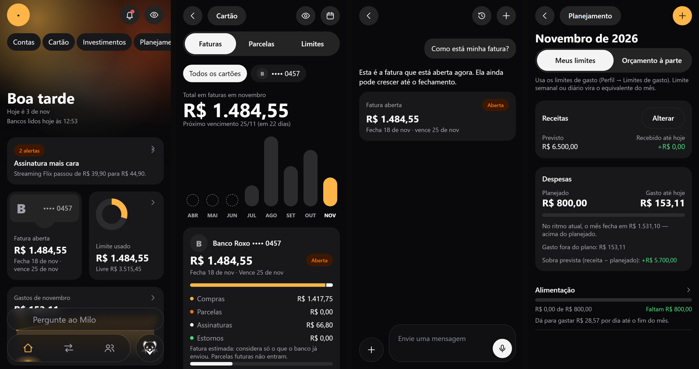
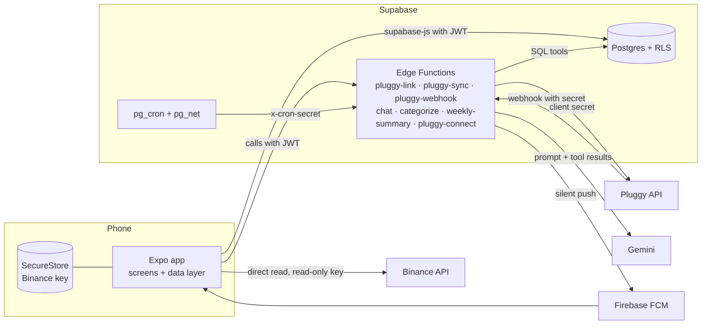

# Milo: a personal finance app on Open Finance, built in 8 days

[Português](README.md) · **English**

> A case study with no code. How I put the app together, what broke along the way and what I would do differently.

**▶ 84 s video:** [watch in the player](media/milo-demo.mp4) (pause and scrub back) · [download the .mp4](media/milo-demo.mp4?raw=true) · captions are in Portuguese

| time | | time | |
| --- | --- | --- | --- |
| 0:00 | intro | 0:50 | chat with tools |
| 0:03 | widget-based home | 1:02 | investments |
| 0:11 | hide values | 1:07 | monthly plan |
| 0:14 | computed open bill | 1:12 | connection health |
| 0:23 | spending by group | 1:17 | outro |
| 0:31 | a category fix becomes a rule | | |

All data in the video and images is fictional (the app's own demo mode). No real bank data appears in this repository.

---

## In one sentence

Milo pulls my bank accounts and credit cards through Brazil's Open Finance, shows the open card bill, spending and the monthly plan, and has an assistant that answers questions like "how much did I spend on groceries in the last 30 days?" with numbers taken from the database, never made up by the model.

It is for personal use, for me and a few family members. It is not in the app stores and costs nothing.

| | |
| --- | --- |
| Time | 8 days of building (Oct 8–15, 2026), then a few days of use and fixes |
| Commits | 51 |
| App | ~11k lines of TypeScript, 35 screens |
| Backend | 19 tables with RLS, 11 migrations, 7 Edge Functions, 4 pg_cron jobs |
| Tests | 56 cases in the test plan, Playwright + axe on the web demo, manual checks on the phone over adb |
| Who | me, pair-programming with Claude Code |

---

## 1. How I built it

### Stack

| layer | choice | why |
| --- | --- | --- |
| App | Expo SDK 57, expo-router, TypeScript | one codebase for Android, iOS and web. The web build is the demo and the target for automated tests |
| Database and auth | Supabase (Postgres, Auth, Edge Functions, pg_cron, pg_net) | one place for data, access rules, jobs and the functions that hold secrets |
| Open Finance | Pluggy (Meu Pluggy) | a licensed aggregator, free for personal use |
| AI | Gemini Flash-Lite, only inside an Edge Function | cheap and fast; the key never ships in the app |
| Push | Firebase Cloud Messaging + local notifications | a silent push wakes the app when a new purchase arrives |
| iOS | unsigned `.ipa` built on GitHub Actions (macOS), signed on the iPhone by SideStore | I have no Mac and no paid Apple account |

### Architecture

### The rules that shaped everything else

1. **The brain lives on the server.** The app displays and executes. Anything that needs a secret (Pluggy, Gemini, Firebase) runs in an Edge Function, because an APK can be decompiled in minutes. The app only carries the Supabase URL and anon key, which are public by design.
2. **RLS on every table.** The app reads and writes directly with `supabase-js`, and Postgres makes sure each user only sees their own rows. I tested it with a second user: they can't read, can't insert on behalf of the first user and can't change the first user's rows.
3. **The model doesn't do math.** The assistant uses *tools* that are SQL queries run with the user's JWT, so RLS still applies. The prompt forbids adding numbers up, and the answer cards are built from the tool's JSON, not from the model's text. If the model gets a sentence wrong, the number on the card is still right.

   
4. **One data layer, two implementations.** From day one the screens talk to one interface (`data.ts`). It has an in-memory version with fictional data and a Supabase version with the same signatures. This paid for the whole project: screens were built before the backend, tests run without touching real data, and this video was recorded on it.
5. **Vertical slice first.** The first delivery was the thinnest end-to-end path: connect a bank → see the transactions → ask "how much did I spend this month?". It proved Pluggy, RLS, Gemini with tools and the APK on the phone before any polished screen existed.

### The process

I worked in short stages, each with a written output:

1. **Product map:** screen inventory, flows, an inferred data model and a feature matrix with priorities (must, should, could).
2. **Architecture:** stack, a SQL schema with indexes and access rules, routes per flow, and a list of "the parts that bite" (time zones, idempotency, the open bill…). Writing that list before coding avoided half of the bugs. The other half is in section 2.
3. **Design system:** color, type and spacing tokens in a `theme.ts`, with no hard-coded colors in components. Its own identity: Milo is a stoat, with an amber accent.
4. **Screen-by-screen build** on fictional data, ticking off the feature matrix.
5. **Backend:** migrations, RLS, Edge Functions, webhooks and jobs.
6. **Testing:** a plan with happy paths and edge cases per flow, Playwright on the web, the phone over adb for the rest.
7. **Reading reviews:** 470 public reviews of another AI finance app (App Store, Google Play and Reclame Aqui, a Brazilian complaints site), grouped by theme. The theme that runs through every source is **"the numbers don't match my bank"**, and that became Milo's main priority.

### Timeline

| day | what shipped |
| --- | --- |
| Oct 8 | scaffold, product map, architecture, design system, tab shell, Home, Activity, Detail, Categories, Assistant (all on fictional data); schema and Edge Functions |
| Oct 9 | hooked up to the real Supabase, login |
| Oct 11 | first APK on the phone with real data; manual entries, subscriptions, alerts, filters, credit card |
| Oct 13 | notifications, spending limits, reminders, card calendar, refunds and bill breakdown, foreign purchases, conversations, weekly summary, pg_cron, biometric lock, FCM push, investments (Binance) |
| Oct 14 | category rules, monthly plan, assistant memories, Milo identity, receipt photo, voice input, CSV export, test round, AI categorization, review analysis, simple login for family |
| Oct 15 | login and keyboard fixes on a slow phone, `.ipa` for iPhone |
| Oct 17 | diagnosing a bank that stopped syncing, and the connection health screen |

---

## 2. What broke

Everything below really happened. The format is symptom → cause → fix.

### Money and dates

**Foreign purchases showed up in dollars as if they were reais.** A US$ 21.99 subscription came in as R$ 21.99.
→ The sync stored the `amount` field, which is in the original currency. The amount in the account's currency is in `amountInAccountCurrency`.
→ I switched fields, and a migration fixed the old rows from the raw JSON I kept for each transaction. Keeping the `raw` payload is what made the fix possible without a re-import.

**The card bill didn't match the bank's app.** It was off by hundreds of reais.
→ Credits on the card (refunds, "debt settlement") were ignored. Only the bill payment itself should be left out.
→ Refunds now reduce the bill, and the bill got a breakdown (purchases, installments, subscriptions, refunds) so you can check it line by line against the bank.

**Purchases made on the closing day landed on the wrong bill.** I built the cycle assuming the closing day still belongs to the bill that closes. At the bank, the cycle *restarts* that day: with a closing day of the 18th, a purchase on the 18th goes to the next bill.
→ I fixed the rule and added a closing-day picker per card. The lesson: check business rules against the real statement, not against my intuition.

**The same purchase appeared twice.** The aggregator sends a transaction as pending and then as posted, with different ids.
→ A function hides the pending one when a posted one exists with the same account, direction, amount and day. For alerts, "already notified" uses merchant + amount + day, not the id.

**Dates one day early.** `new Date('2026-10-08')` becomes midnight UTC, which in Brazil is 9 p.m. on the 7th. This bug was in the architecture doc before the first line of code, and it still showed up in two places.
→ The database stores `date` (a day, no time), the app formats the `YYYY-MM-DD` string directly, and "current month" and the cron jobs are computed in `America/Sao_Paulo`.

### Integrations

**A bank stopped syncing silently.** Two banks went six days without new data, and nothing in the app said so.
→ The aggregator had dropped those connections from automatic sync (`nextAutoSyncAt` was null). Asking for a manual refresh always returned `400 "MeuPluggy item cant be updated"`: in this connection mode, refreshing is impossible. The only way out is to reconnect the bank, which creates a new item, with new account rows in the database.
→ Three changes. The manual refresh is no longer fatal and shows the aggregator's error. Each connection shows "Bank read at…", which turns red after 2 days, with a "Stopped" badge. And Home has pull-to-refresh and a freshness line ("Banks read today at…").

**"Real time" doesn't exist on this path.** The connection mode I used reads each bank once every 24 h, and you can't force it. Worse: the bank sends the balance and the limit before the list of purchases, so for a few hours the balance already includes purchases that don't show in the list yet.
→ Still open. The idea is to read the bank app's notifications on Android to show a purchase right away as pending, and reconcile it when the aggregator delivers.

**Binance blocked the server.** The Supabase project is in `us-east-1`, and Binance refuses US IPs.
→ Binance is read from the phone. The HMAC signature is done in pure JavaScript (checked against Node), and the read-only key stays in the device's SecureStore, never on the server.

**The scheduler had never run.** The 6-hour sync fallback was in the code from day one, but `pg_cron` had never been applied to the database. I found out five days later, while building the weekly summary.
→ The jobs were applied, and every job→function call now authenticates with a secret kept in the Supabase Vault.

**The model got calendar math wrong.** Flash-Lite mixed up "last week" and "weekend". And the generic model names (aliases) returned 503 and 404 on some days.
→ The prompt now carries precomputed dates (yesterday, this week, last week, weekend, last month), and the model is pinned to one version.

### Family login

When I opened the app to family members, both ways to sign in failed on the first try:

- **Google** said "misconfigured" (`DEVELOPER_ERROR`). The signing certificate's SHA-1 fingerprint was missing in Firebase, and there was no Android OAuth client in Google Cloud. No rebuild was needed.
- **Email code** said "Error sending confirmation email". Three problems were stacked: the SMTP username wasn't the full Gmail address, the normal password had been saved instead of an app password (`534 Application-specific password required`), and the confirmation template had no `{{ .Token }}`.
- **The keyboard covered the fields** on a slower phone. The code scrolled when the keyboard appeared, but on that device the event fired before the screen shrank. It now scrolls when the layout changes while the keyboard is visible.

### Build and tooling

- `expo prebuild` **wipes the whole `android/` folder**, including manual Gradle memory settings and the SDK path. It happened with every new native module (biometrics, SecureStore, blur).
- The free cloud build quota ran out mid-project, so release builds moved to my machine (about 4 minutes).
- On Windows, Metro sometimes didn't notice file edits. The automated tests start by restarting the server with a clean cache.
- Real blur on the Android tab bar needs one blur target per tab. The React Compiler kept a stale reference to the target, and the bar lost its blur. The fix was reading the target with `useSyncExternalStore` instead of a version counter.
- A formatter run without a config would have reformatted whole files and polluted the history. It is banned in this repo.

### Bugs the tests caught

The test round ran 56 cases and found 8 bugs. The two worst:

- **Disconnecting a bank wiped everything in one tap** (transactions, hand-fixed categories, recurring flags). Top severity. Now the first tap shows what will be deleted, and only the second one confirms.
- **"Hide values" leaked.** Amounts on screen became `R$ ••••`, but one alert's text still said "went from R$ 39.90 to R$ 44.90".

The rest were accessibility issues (arrows with no button role for screen readers), a form opened from a link that didn't know where to go back to, and layout details.

---

## 3. What I would change

1. **Test the aggregator's limits before designing the product.** Reads every 24 h, no manual refresh, connections dropping out of automatic sync, a trial period that locks the list of banks: I found all of this by using the app. One day spent only on the API, before the first screen, would have changed the app's promise ("today's spending", not "real time") and put connection health in the first version.
2. **Supabase in São Paulo (`sa-east-1`).** The data and the users are in Brazil. It would have avoided the Binance block, the extra latency and the question of where the data lives.
3. **Reconciliation tests from day one.** The worst bugs were about amounts (currency, refunds, the card cycle, duplicates), and the same test would have caught all of them: Milo's bill total equals the bank app's total. Today that is checked by eye. It would become an automated test with fictional statements that cover each case.
4. **Migrations and jobs applied by CI, with a check.** A job that exists in the repo but not in the database is worse than no job. A deploy step that lists `cron.job` and fails if something is missing would have caught it on day one.
5. **Native config through a config plugin.** Every setting that `prebuild` wipes should live in an Expo config plugin, so the build is reproducible on any machine, including the iPhone CI.
6. **Smaller, more frequent commits.** Several times I ended the day with features done, installed on the phone and outside git. In an app that handles money, I want to be able to go back to any version.
7. **Less feature parity, more of my own problem.** At first I measured Milo against another app's feature matrix. What paid off most came from elsewhere: the 470 reviews and my own daily use. Configurable agents, for example, became quick questions, because that's what I actually used.

### What I would keep

- The data layer with a fictional version, which served the screens before the backend, the tests, the demo and this video.
- "The model doesn't add", with numbers only from tools and cards built from JSON.
- A category fix that becomes a rule: the app asks whether to apply it to every purchase from the same store, and new purchases arrive already right. The AI only categorizes what arrives uncategorized, only when it's confident, never over a choice I made, and always with "Undo".
- Writing down "the parts that bite" before coding.

---

## 4. What's next

The review analysis produced this list, in order:

1. Milo's bill next to the bank's amount, with the difference explained.
2. A warning on every screen when a connection errors or has been stuck for more than 24 h (today it only shows in Connections and on Home).
3. "Ignore in totals" for duplicates that slip past the automatic rule.
4. A 30-day projection.
5. User-created categories.
6. A monthly report to share.

---

## About this repository

- **Why no code:** the app holds financial data for me and my family, and the private repo has project configuration (Supabase, Firebase) that makes no sense to expose. This repo holds only what you can learn from it.
- **Data:** the video and images were recorded in demo mode, with fictional banks, stores and amounts ("Banco Roxo", "Cafeteria Grão").
- **Tools:** the video was recorded with Playwright on the app's web build (phone viewport) and edited with ffmpeg.
