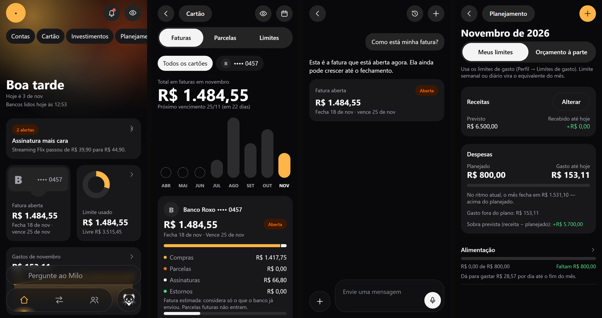
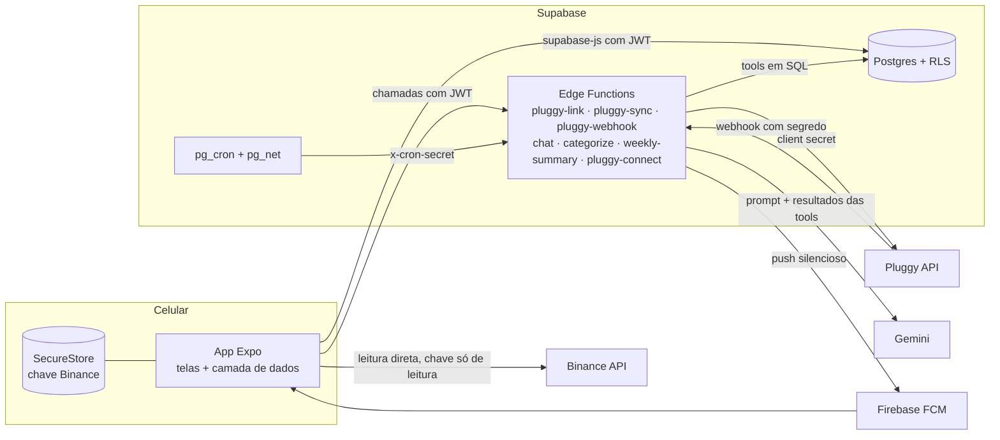

# Milo: um app de finanças pessoais com Open Finance, em 8 dias

**Português** · [English](README.en.md)

### Destaques

- **O modelo é proibido de calcular.** As tools do assistente são consultas SQL executadas com o JWT do usuário, então a RLS continua valendo. Os cards da resposta são montados com o JSON da tool, não com o texto gerado.
- **Uma camada de dados com duas implementações.** A versão fictícia em memória e a do Supabase têm as mesmas assinaturas: as telas foram feitas antes do backend, os testes rodam sem tocar em dado real, e o vídeo foi gravado nela.
- **Bugs de valor rastreados até a causa.** Compra internacional gravada na moeda original, estornos ignorados na fatura e o ciclo do cartão que recomeça no dia do fechamento, cada um com sintoma, causa e correção na seção 2. Guardar o JSON bruto de cada transação permitiu consertar sem reimportar.

| | |
| --- | --- |
| Tempo | 8 dias de construção (08/10 a 15/10/2026) e alguns dias de uso e correção depois |
| Commits | 51 |
| App | ~11 mil linhas de TypeScript, 35 telas |
| Backend | 19 tabelas com RLS, 11 migrações, 7 Edge Functions, 4 jobs no pg_cron |
| Testes | 56 casos no plano de teste, Playwright + axe na web demo, verificação manual no celular via adb |

**▶ Vídeo de 84 s:** [assistir com player](media/milo-demo.mp4) (dá para pausar e voltar) · [baixar o .mp4](media/milo-demo.mp4?raw=true)

| trecho | | trecho | |
| --- | --- | --- | --- |
| 0:00 | abertura | 0:50 | chat com tools |
| 0:03 | Início em widgets | 1:02 | investimentos |
| 0:11 | ocultar valores | 1:07 | planejamento do mês |
| 0:14 | fatura aberta calculada | 1:12 | saúde das conexões |
| 0:23 | gastos por grupo | 1:17 | fechamento |
| 0:31 | categoria vira regra | | |

Todos os dados do vídeo e das imagens são fictícios (modo demonstração do próprio app). Nenhum dado bancário real aparece neste repositório.

---

> Case study sem código. Como montei o app, o que quebrou no caminho e o que eu faria diferente.

## Em uma frase

O Milo junta minhas contas e cartões pelo Open Finance, mostra a fatura aberta, os gastos e o planejamento do mês, e tem um assistente que responde perguntas como "quanto gastei com mercado nos últimos 30 dias?" com números tirados do banco de dados, nunca inventados pelo modelo.

É um app de uso pessoal, para mim e para alguns familiares. Não está nas lojas e não cobra nada.

---

## 1. Como montei

### Stack

| camada | escolha | por quê |
| --- | --- | --- |
| App | Expo SDK 57, expo-router, TypeScript | um código para Android, iOS e web. A web serve de demo e de alvo para testes automáticos |
| Banco e auth | Supabase (Postgres, Auth, Edge Functions, pg_cron, pg_net) | um lugar só para dados, regras de acesso, jobs e funções com segredo |
| Open Finance | Pluggy (Meu Pluggy) | agregador licenciado, gratuito para uso pessoal |
| IA | Gemini Flash-Lite, só dentro de Edge Function | barato e rápido; a chave nunca vai para o app |
| Push | Firebase Cloud Messaging + notificações locais | push silencioso acorda o app quando chega compra nova |
| iOS | `.ipa` sem assinatura gerado no GitHub Actions (macOS) e assinado no iPhone pela SideStore | não tenho Mac nem conta paga da Apple |

### Arquitetura

### As regras que guiaram o resto

1. **O cérebro fica no servidor.** O app mostra e executa. Tudo que precisa de segredo (Pluggy, Gemini, Firebase) roda numa Edge Function, porque um APK se descompila em minutos. No app só vão a URL e a chave anônima do Supabase, que são públicas por design.
2. **RLS em toda tabela.** O app lê e grava direto pelo `supabase-js`, e o Postgres garante que cada usuário só vê o que é dele. Testei com um segundo usuário: ele não lê, não insere em nome do primeiro e não altera linhas dele.
3. **O modelo não faz conta.** O assistente usa *tools* que são consultas SQL executadas com o JWT do usuário (então a RLS continua valendo). O prompt proíbe somar, e os cards da resposta são montados com o JSON da tool, não com o texto do modelo. Se o modelo errar a frase, o número no card continua certo.

   
4. **Uma camada de dados com duas implementações.** Desde o primeiro dia as telas falam com uma interface (`data.ts`), que tem uma versão em memória com dados fictícios e outra no Supabase, com as mesmas assinaturas. Isso pagou o projeto inteiro: as telas foram feitas antes do backend, os testes rodam sem tocar em dado real, e este vídeo foi gravado nela.
5. **Fatia vertical primeiro.** A primeira entrega foi o caminho mais fino de ponta a ponta: conectar um banco → ver as transações → perguntar "quanto gastei este mês?". Isso provou Pluggy, RLS, Gemini com tools e o APK no celular antes de qualquer tela bonita.

### O processo

O desenvolvimento foi feito em par com o Claude Code, como método de trabalho. Continuaram sendo decisão minha a arquitetura, a investigação dos bugs de valor e as regras de reconciliação da fatura.

Trabalhei em etapas curtas, cada uma com um documento de saída:

1. **Mapa do produto:** inventário de telas, fluxos, modelo de dados inferido e uma matriz de funções com prioridade (obrigatória, recomendada, opcional).
2. **Arquitetura:** stack, schema em SQL com índices e regras de acesso, rotas por fluxo e a lista de "partes que mordem" (fuso, idempotência, fatura aberta…). Escrever essa lista antes de programar evitou metade dos bugs. A outra metade está na seção 2.
3. **Design system:** tokens de cor, tipografia e espaçamento num `theme.ts`, sem cor solta em componente. Identidade própria: o Milo é um arminho, com destaque âmbar.
4. **Construção tela a tela** sobre dados fictícios, marcando a matriz de funções.
5. **Backend:** migrações, RLS, Edge Functions, webhooks e jobs.
6. **Teste:** plano com caminho feliz e casos de borda por fluxo, Playwright na web, celular via adb para o resto.
7. **Leitura de avaliações:** 470 avaliações públicas de outro app de finanças com IA (App Store, Google Play e Reclame Aqui), agrupadas por tema. O tema que atravessa todas as fontes é **"os números não batem com o banco"**, e isso virou o critério de prioridade do Milo.

### Linha do tempo

| dia | o que saiu |
| --- | --- |
| 08/10 | scaffold, mapa do produto, arquitetura, design system, shell com abas, Início, Atividades, Detalhe, Categorias, Assistente (todos sobre dados fictícios); schema e Edge Functions |
| 09/10 | ligação com o Supabase real, login |
| 11/10 | primeiro APK no celular com dado real; lançamento manual, assinaturas, alertas, filtros, cartão |
| 13/10 | notificações, limites de gasto, lembretes, calendário do cartão, estornos e composição da fatura, compra internacional, conversas, resumo semanal, pg_cron, bloqueio por biometria, push FCM, investimentos (Binance) |
| 14/10 | regras de categoria, planejamento do mês, memórias do assistente, identidade Milo, foto de comprovante, voz, CSV, rodada de testes, categorização por IA, leitura das avaliações, login simples para a família |
| 15/10 | correções de login e teclado em celular lento, `.ipa` para iPhone |
| 17/10 | diagnóstico de banco que parou de sincronizar e tela de saúde das conexões |

---

## 2. O que quebrou

Cada item abaixo aconteceu de verdade. O formato é sintoma → causa → correção.

### Dinheiro e datas

**Compra internacional aparecia em dólar como se fosse real.** Uma assinatura de US$ 21,99 entrava como R$ 21,99.
→ O sync gravava o campo `amount`, que vem na moeda original. O valor na moeda da conta está em `amountInAccountCurrency`.
→ Troquei o campo, e uma migração corrigiu as linhas antigas a partir do JSON bruto que eu guardava de cada transação. Guardar o `raw` foi o que permitiu consertar sem reimportar.

**A fatura não batia com o app do banco.** A diferença era de centenas de reais.
→ Créditos no cartão (estornos, "encerramento de dívida") eram ignorados. Só o pagamento da fatura deveria ficar de fora.
→ Estornos passaram a abater a fatura, e ela ganhou uma composição (compras, parcelas, assinaturas, estornos) para dar para conferir linha a linha com o banco.

**Compras do dia do fechamento caíam na fatura errada.** Implementei o ciclo achando que o dia do fechamento ainda pertencia à fatura que fecha. No banco, o ciclo *recomeça* nesse dia: com fechamento no dia 18, uma compra do dia 18 já vai para a próxima fatura.
→ Corrigi a regra e criei um seletor de dia de fechamento por cartão. A lição foi conferir regra de negócio contra o extrato real, não contra a minha intuição.

**A mesma compra aparecia duas vezes.** O agregador manda a transação como pendente e depois como postada, com ids diferentes.
→ Uma função esconde a pendente quando existe uma postada com mesma conta, direção, valor e dia. Para alertas, o "já avisei" usa comerciante + valor + dia, não o id.

**Datas um dia antes.** `new Date('2026-10-08')` vira meia-noite UTC, que no Brasil é 07/10 às 21h. Esse bug estava listado na arquitetura antes da primeira linha de código, e mesmo assim apareceu em dois lugares.
→ O banco guarda `date` (dia, sem hora), o app formata a string `YYYY-MM-DD` direto, e "mês atual" e cron são calculados em `America/Sao_Paulo`.

### Integrações

**O banco parou de sincronizar em silêncio.** Dois bancos ficaram seis dias sem dado novo, e nada no app avisava.
→ O agregador tirou essas conexões da sincronização automática (`nextAutoSyncAt` nulo). Pedir atualização manual sempre dava `400 "MeuPluggy item cant be updated"`: nesse modo de conexão, atualizar é impossível. A única saída é reconectar o banco, o que cria um item novo, com contas novas no banco de dados.
→ Três mudanças. A atualização manual deixou de ser fatal e passou a mostrar o erro do agregador. Cada conexão mostra "Banco lido em…", que fica vermelho depois de 2 dias, com um selo "Parado". E o Início tem puxar para atualizar e uma linha de frescor ("Bancos lidos hoje às…").

**"Tempo real" não existe nesse caminho.** O modo de conexão que usei lê cada banco uma vez a cada 24 h, e não dá para forçar. Pior: o banco manda o saldo e o limite antes da lista de compras, então por algumas horas o saldo já inclui compras que ainda não aparecem na lista.
→ Ainda aberto. A ideia é ler as notificações do app do banco no Android para mostrar a compra na hora, como pendente, e reconciliar quando o agregador entregar.

**A Binance bloqueava o servidor.** O projeto do Supabase está em `us-east-1`, e a Binance recusa IPs dos EUA.
→ A Binance é lida pelo celular. A assinatura HMAC é feita em JavaScript puro (conferida contra o Node), e a chave, só de leitura, fica no SecureStore do aparelho, nunca no servidor.

**O agendador nunca tinha rodado.** O fallback de sincronização a cada 6 h existia no código desde o primeiro dia, mas o `pg_cron` nunca tinha sido aplicado no banco. Descobri cinco dias depois, ao criar o resumo semanal.
→ Os jobs foram aplicados, e cada chamada agenda→função passou a se autenticar com um segredo guardado no Vault do Supabase.

**O modelo errava conta de calendário.** O Flash-Lite confundia "semana passada" e "fim de semana". E os nomes genéricos de modelo (aliases) davam 503 e 404 em alguns dias.
→ O prompt passou a levar as datas já calculadas (ontem, esta semana, semana passada, fim de semana, mês passado), e o modelo ficou fixado numa versão.

### Login da família

Quando abri o app para familiares, os dois jeitos de entrar falharam no primeiro teste:

- **Google** mostrava "mal configurado" (`DEVELOPER_ERROR`). Faltava a impressão digital SHA-1 do certificado no Firebase e um cliente OAuth Android no Google Cloud. Não precisou de rebuild.
- **Código por e-mail** dava "Error sending confirmation email". Eram três problemas empilhados: o usuário do SMTP não era o endereço completo do Gmail, foi salva a senha normal em vez de uma senha de app (`534 Application-specific password required`), e o template de confirmação não tinha o `{{ .Token }}`.
- **O teclado cobria os campos** num celular mais lento. O código rolava a tela quando o teclado aparecia, mas nesse aparelho o evento chegava antes da tela encolher. Passei a rolar quando o layout muda com o teclado visível.

### Build e ferramentas

- `expo prebuild` **apaga a pasta `android/` inteira**, junto com ajustes manuais de memória do Gradle e o caminho do SDK. Aconteceu a cada módulo nativo novo (biometria, SecureStore, blur).
- A cota grátis de builds na nuvem acabou no meio do projeto, então o release passou a ser compilado localmente (cerca de 4 minutos).
- O Metro, no Windows, às vezes não percebia edições de arquivo. Os testes automáticos começam reiniciando o servidor com cache limpo.
- O desfoque real da barra inferior no Android pede um alvo de blur por aba. O React Compiler guardava uma referência antiga ao alvo, e a barra ficava sem blur. A solução foi ler o alvo com `useSyncExternalStore` em vez de um contador de versão.
- Um formatador rodado sem configuração reformataria arquivos inteiros e sujaria o histórico. Ficou proibido neste repositório.

### Bugs que os testes pegaram

A rodada de testes rodou 56 casos e achou 8 bugs. Os dois piores:

- **Desconectar um banco apagava tudo num toque** (transações, categorias corrigidas à mão, marcações). Severidade máxima. Hoje o primeiro toque mostra o que vai ser apagado, e só o segundo confirma.
- **"Ocultar valores" vazava.** Os valores das telas viravam `R$ ••••`, mas o texto de um alerta continuava "passou de R$ 39,90 para R$ 44,90".

O resto era acessibilidade (setas sem papel de botão para o leitor de tela), um formulário aberto por link que não sabia para onde voltar e detalhes de layout.

---

## 3. O que eu mudaria

1. **Validar os limites do agregador antes de desenhar o produto.** Leitura a cada 24 h, atualização manual impossível, conexão que sai da sincronização automática, período de teste que trava a lista de bancos: descobri tudo isso usando. Um dia de testes só com a API, antes da primeira tela, teria mudado a promessa do app ("seus gastos do dia", não "em tempo real") e colocado a saúde das conexões na primeira versão.
2. **Supabase em São Paulo (`sa-east-1`).** Os dados e os usuários são do Brasil. Teria evitado o bloqueio da Binance, a latência extra e a dúvida sobre onde os dados ficam.
3. **Testes de reconciliação desde o primeiro dia.** Os piores bugs foram de valor (moeda, estornos, ciclo do cartão, duplicadas), e todos eram verificáveis com o mesmo teste: o total da fatura do Milo igual ao do app do banco. Hoje isso é conferido a olho. Viraria um teste automático com extratos fictícios que cobrem cada caso.
4. **Migrações e jobs aplicados por CI, com verificação.** Um job que existe no repositório e não existe no banco é pior do que não ter o job. Um passo de deploy que lista `cron.job` e falha se faltar algo teria pegado o problema no primeiro dia.
5. **Configuração nativa por config plugin.** Todo ajuste que o `prebuild` apaga deveria morar num plugin do Expo, para o build ser reproduzível em qualquer máquina, inclusive no CI do iPhone.
6. **Commits menores e mais frequentes.** Várias vezes terminei o dia com funções prontas, instaladas no celular e fora do git. Num app que mexe com dinheiro, eu quero poder voltar a qualquer versão.
7. **Menos paridade, mais problema próprio.** No começo medi o Milo pela matriz de funções de outro app. O que mais valeu veio de outro lugar: as 470 avaliações e o meu uso diário. Agentes configuráveis, por exemplo, viraram perguntas rápidas, porque era isso que eu realmente usava.

### O que eu manteria

- A camada de dados com versão fictícia, que serviu para telas antes do backend, testes, demo e este vídeo.
- "O modelo não soma", com números só das tools e cards montados com JSON.
- A correção de categoria que vira regra: o app pergunta se aplica a todas da mesma loja, e as próximas compras já chegam certas. A IA só categoriza o que chega sem categoria, só quando tem confiança, nunca por cima de uma escolha minha, e sempre com "Desfazer".
- Escrever as "partes que mordem" antes de programar.

---

## 4. O que vem agora

Da leitura das avaliações saiu esta lista, em ordem:

1. Fatura do Milo e valor do banco lado a lado, com a diferença explicada.
2. Aviso de conexão com erro ou parada há mais de 24 h, em todas as telas (hoje só em Conexões e no Início).
3. "Ignorar nos totais" para duplicadas que escapam da regra automática.
4. Projeção dos próximos 30 dias.
5. Categorias criadas pelo usuário.
6. Relatório do mês para compartilhar.

---

## Sobre este repositório

- **Por que sem código:** o app guarda dados financeiros meus e da minha família, e o repositório privado tem configuração de projeto (Supabase, Firebase) que não faz sentido expor. Aqui fica só o que dá para aprender com ele.
- **Dados:** vídeo e imagens foram gravados no modo demonstração, com bancos, lojas e valores fictícios ("Banco Roxo", "Cafeteria Grão").
- **Ferramentas:** o vídeo foi gravado com Playwright na versão web do app (viewport de celular) e montado com ffmpeg.

---

Outro case study: [Otto](https://github.com/Morosetti/otto-case-study)
